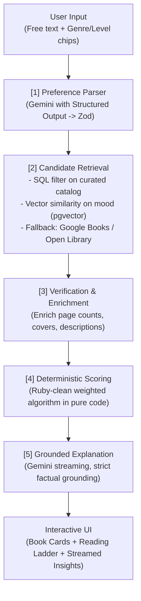

# BookCompass 🧭
> **AI-Powered Book Recommender for Beginners to Advanced Readers**

BookCompass is a portfolio-grade GenAI web application built to solve a classic reader dilemma: *where do I start?* Instead of vague popularity rankings, BookCompass recommends the best books based on a reader's **genre**, **reading level** (beginner, intermediate, advanced), and optional **mood/preferences**. It writes grounded explanations and constructs an escalating **reading ladder** (read X, then Y, then Z).

---

## 🌟 Core Principle: Zero Hallucination

> **The LLM never invents book facts.**

A primary engineering constraint in BookCompass is avoiding LLM hallucination:
- **LLM role**: Understand user intent (extract structured preferences) and explain *why* the verified books match the user's criteria.
- **Database / API role**: All book facts (titles, authors, genuine page counts, descriptions, and cover imagery) come strictly from our curated database or verified API lookups (Google Books API / Open Library API).
- **Hard drop policy**: Any candidate that cannot be verified against our catalog or external book authority APIs is dropped immediately prior to scoring and presentation.

---

## 🏗️ Architecture



---

## 📐 Reader Level Rubric (`lib/scoring/rubric.ts`)

Reading levels are strictly defined in deterministic code as the single source of truth:

| Level | Page Range | Complexity | Language | Typical Traits |
| :--- | :--- | :--- | :--- | :--- |
| **beginner** | 100–300 | 1 | Easy | Fast pacing, few characters, linear plot, standalone or light series |
| **intermediate** | 250–450 | 2–3 | Moderate | Subplots, steady pacing, multiple POVs allowed, moderate twists |
| **advanced** | 400–1200 | 4–5 | Demanding | Layered, non-linear, slow burn, literary quality, large casts, heavy themes |

---

## 🧮 Deterministic Scoring (`lib/scoring/score.ts`)

All candidate scoring is calculated via pure TypeScript functions, completely independent of LLM temperature or variance:

$$\text{score} = 0.35 \times \text{levelMatch} + 0.25 \times \text{genreMatch} + 0.20 \times \text{semanticSimilarity} + 0.10 \times \text{rating} + 0.10 \times \text{lengthFit}$$

### Scoring Breakdown:
- **`levelMatch` (0.35)**: `1.0` for exact level match, `0.5` for adjacent level, `0.0` otherwise.
- **`genreMatch` (0.25)**: Fraction of user-selected genres present in the book's verified genres.
- **`semanticSimilarity` (0.20)**: Cosine similarity score against the query vector generated by Gemini embeddings (`text-embedding-004`).
- **`rating` (0.10)**: Normalized average rating ($0.0 - 1.0$).
- **`lengthFit` (0.10)**: `1.0` within the level's defined page window, with graceful linear decay outside the range.
- **Avoid penalty**: Books with tags matching keywords in the user's avoid list receive a $0.10\times$ penalty multiplier.

---

## 🛠️ Tech Stack & Decision Record

| Layer | Technology | Decision Record |
| :--- | :--- | :--- |
| **Framework** | Next.js 16 (App Router) | React Server Components, Route Handlers, and Partial Prefetching. |
| **Styling & UI** | Tailwind CSS v4, Lucide Icons, Framer Motion | Modern mobile-first responsive design, light/dark mode support, smooth animations. |
| **LLM & Embeddings** | Google Gemini (`gemini-2.5-flash` & `text-embedding-004`) | High instruction-following performance, low latency, native structured output, 768-dim embeddings. |
| **Orchestration** | LangChain JS (`@langchain/google-genai`, `@langchain/core`) | Clean prompts, structured output integration, and token streaming. |
| **Database** | Supabase (Postgres + pgvector) | Relational database + vector search in one engine. Hosted, high performance, and supports HNSW vector indexing. |
| **Book APIs** | Google Books API & Open Library API | Real page counts, official ISBNs, cover art, and authoritative descriptions. |
| **Rate Limiting** | Upstash Redis + `@upstash/ratelimit` | Sliding window rate limiting (10 req/min/IP and 50 req/day/IP) to prevent abuse and API exhaustion. |
| **Testing** | Vitest | Lightning-fast TypeScript unit tests covering scoring and schema parsing. |
| **Hosting** | Vercel | Seamless Next.js deployment with Edge/Node.js runtime support. |

---

## 🚀 Getting Started

### 1. Prerequisites
- Node.js 20+
- A Google AI Studio API key ([aistudio.google.com](https://aistudio.google.com/))
- A Supabase project ([supabase.com](https://supabase.com/))
- An Upstash Redis database ([upstash.com](https://upstash.com/))

### 2. Clone and Install
```bash
git clone https://github.com/your-username/bookcompass.git
cd bookcompass
npm install --legacy-peer-deps
```

### 3. Environment Variables
Copy `.env.example` to `.env.local`:
```bash
cp .env.example .env.local
```

Fill in your secrets:
```env
GOOGLE_API_KEY=your_gemini_api_key
GEMINI_MODEL=gemini-2.5-flash
GEMINI_EMBEDDING_MODEL=text-embedding-004

GOOGLE_BOOKS_API_KEY=your_optional_google_books_key

NEXT_PUBLIC_SUPABASE_URL=https://your-project.supabase.co
NEXT_PUBLIC_SUPABASE_ANON_KEY=your_supabase_anon_key
SUPABASE_SERVICE_ROLE_KEY=your_supabase_service_role_key

UPSTASH_REDIS_REST_URL=https://your-redis.upstash.io
UPSTASH_REDIS_REST_TOKEN=your_upstash_token
```

### 4. Database Setup
Run the SQL schema located in `lib/db/schema.sql` inside your Supabase SQL Editor. This sets up:
- The `vector` extension
- The `books`, `reading_ladders`, and `queries_log` tables
- Cosine vector index (`hnsw`)
- The `match_books` SQL search function
- Row Level Security (RLS) policies

### 5. Seed Catalog Data
Enrich, embed, and insert the curated books catalog:
```bash
npm run seed
```

### 6. Development Server
```bash
npm run dev
```
Open [http://localhost:3000](http://localhost:3000) in your browser.

---

## 🧪 Testing & Verification

Run the full automated test suite and type check:
```bash
# Run unit tests
npm test

# Run ESLint
npm run lint

# Run production build
npm run build
```

---

## 📡 API Contract

### `POST /api/recommend`
Streams recommendations using Server-Sent Events (SSE).

**Request:**
```json
{
  "message": "Something scary and atmospheric, but I'm new to reading horror",
  "genre": "horror",
  "level": "beginner"
}
```

**SSE Events Stream:**
1. `event: books` — Array of top verified `Book` objects with match scores.
2. `event: ladder` — Step-by-step reading progression (steps 1–3).
3. `event: text` — Streamed AI explanation chunks grounded strictly on the book data.
4. `event: done` — Stream completion signal.

### `GET /api/health`
Health check endpoint reporting service status.

---

## 🔮 Future Work (Out of Scope for v1)
- User accounts & saved book lists / reading histories
- Amazon / Goodreads account synchronization
- Multi-language recommendation models
- Direct library checkout integration (OverDrive / Libby)

---

## 📄 License
MIT &bull; Portfolio project by Antigravity
